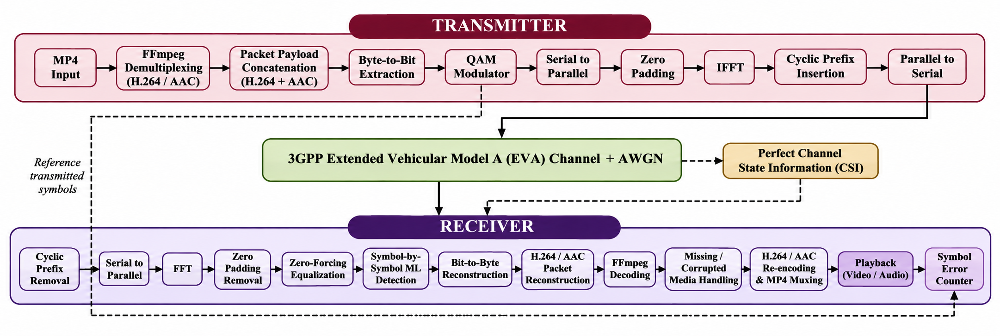
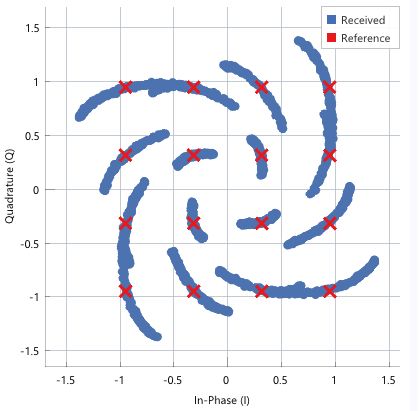
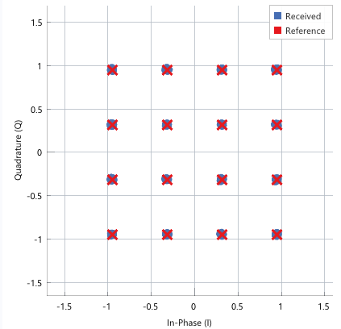
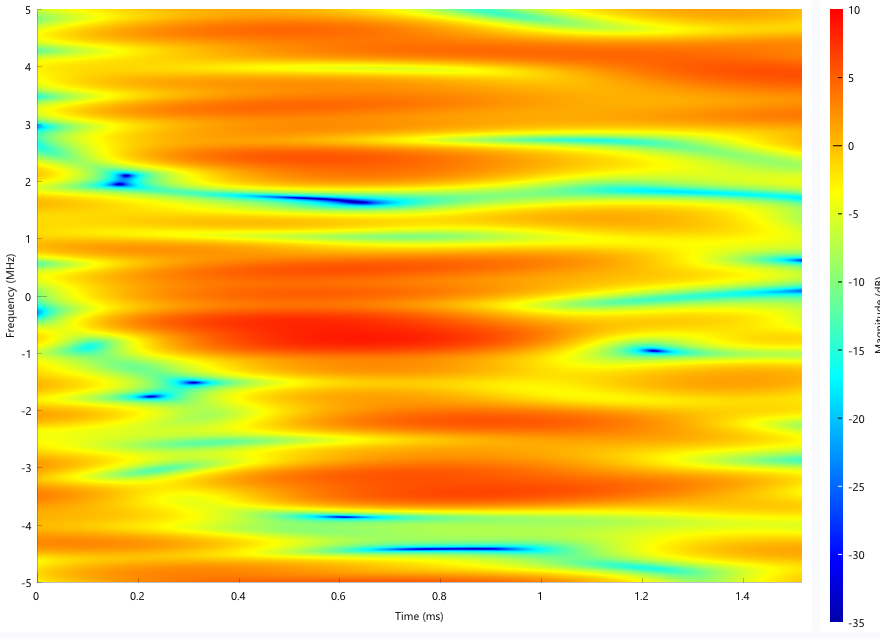
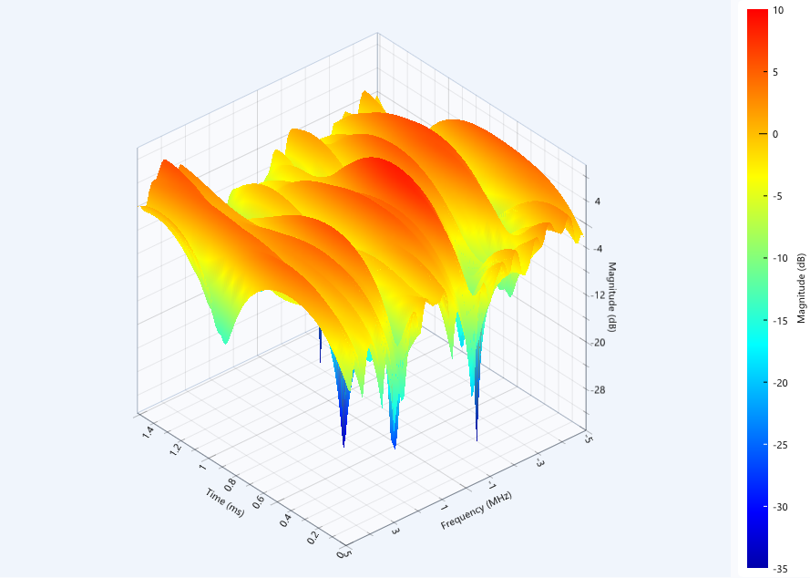

# Orthogonal Frequency-Division Multiplexing (OFDM) Wireless Communication Simulator

A C++ end-to-end OFDM digital communication system simulator demonstrating the transmission and recovery of video and audio over realistic wireless channel conditions. 

The application extracts compressed H.264/AAC media packet payloads from an MP4 input, maps the payload bits onto QAM/OFDM symbols, simulates the wireless channel, and recovers the media at the receiver. The reconstructed media is decoded and re-encoded to produce a playable MP4, including handling for missing or corrupted media.

Key features include live symbol error rate (SER) and throughput statistics, constellation diagrams and 2D/3D channel frequency-response visualizations.

### System Block Diagram

### Demonstration Videos

- [Live Constellation Visualization](assets/ofdm-demo.mp4)
- [Live Channel Frequency Response](assets/channel-demo.mp4)

### Visualization Examples

| Pre-Equalization Constellation | Post-Equalization Constellation |
|:---:|:---:|
|  |  |

| 2D Channel Frequency Response | 3D Channel Frequency Response |
|:---:|:---:|
|  |  |

## Download and Run

Download the Windows executable from the **[v1.0.0 GitHub Release](https://github.com/hesheen-GH/OFDM_WIRELESS_COMMUNICATION_SIMULATOR/releases/tag/v1.0.0)**.
